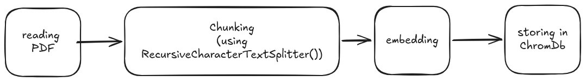
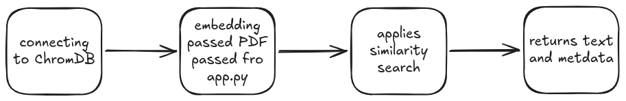

# RECALL

**RECALL** is an AI-powered study assistant built with Retrieval-Augmented Generation (RAG). Upload PDF documents—lecture notes, textbooks, or research papers—and generate summaries, flashcards, key takeaways, or ask targeted questions grounded directly in your material.

--- 

## Features
- **PDF Ingestion & Parsing:** Upload one or multiple PDFs to extract, chunk, and index text automatically.
- **Context-Aware Q&A:** Ask questions about your documents and get answers retrieved from the actual source text.
- **Study Material Generation:** Summarize dense chapters, extract core concepts, and generate flashcards for active recall.
- **Interactive Web Interface:** Clean, responsive UI powered by Streamlit.

--- 
## Installation
### clone the repo

``` bash
git clone https://github.com/zayd-arch/RAG
cd RAG
```
## Install dependecies
``` bash
uv sync
uv run streamlit run app.py
```
--- 
# Tech stack
- **langchain:**handles te chatbot pipeline from embedding(alongside the huggingface sentence_transformer),chuking,prompting,parsing and the llm integration.
- **streamlit:**offers a GUI chat-bot interface with ready to use widgets and simple integration ith back end code and langchain.
- **llm provider:**Groq model "openai/gpt-oss-120b"(free).
- **ChromaDB:**free vector db.
- **pypdf:**to read the pdfs.

## How It Works

- **indexing.py:**

  

- **querying.py:**

  
# Live demo
Hosted on Streamlit Community Cloud: [Open RECALL](https://skbjlcmoqbux6mjuacjhkk.streamlit.app/)


