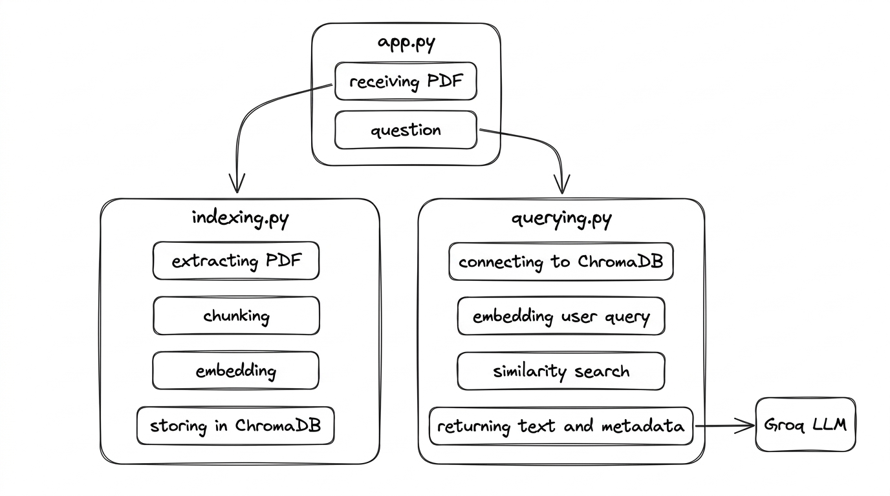

# RECALL

**RECALL** is an AI-powered study assistant built with Retrieval-Augmented Generation (RAG). Upload PDF documents—lecture notes, textbooks, or research papers—and generate summaries, flashcards, key takeaways, or ask targeted questions grounded directly in your material.

--- 
## Motivation

- Moving away from building small predictive models and exploring other applied areas that utilize Retrieval-Augmented Generation (RAG).
- Throughout the project, I discovered the possibility of adding an LLM, evolving **RECALL** from a simple PDF digestor into an end-to-end study chatbot.


## Features
- **PDF Ingestion & Parsing:** Upload one or multiple PDFs to extract, chunk, and index text automatically.
- **Context-Aware Q&A:** Ask questions about your documents and get answers retrieved from the actual source text.
- **Study Material Generation:** Summarize dense chapters, extract core concepts, and generate flashcards for active recall.
- **Interactive Web Interface:** Clean, responsive UI powered by Streamlit.

--- 
## Installation
### clone the repo

``` bash
git clone https://github.com/zayd-arch/RAG
cd RAG
```
## Install dependecies
``` bash
uv sync
uv run streamlit run app.py
```
--- 
# Tech stack
- **langchain:** handles the chatbot pipeline from embedding(alongside the huggingface sentence_transformer),chunking,prompting,parsing and the llm integration.
- **streamlit:** offers a GUI chat-bot interface with ready to use widgets and simple integration with back end code and langchain and provides user session state to keep the chat history will the llm in the session.
- **llm provider:** Groq model "openai/gpt-oss-120b"(free).
- **ChromaDB:** free vector db.
- **pypdf:** to read the pdfs.

## Architecture

# Live demo
Hosted on Streamlit Community Cloud: [Open RECALL](https://skbjlcmoqbux6mjuacjhkk.streamlit.app/)


